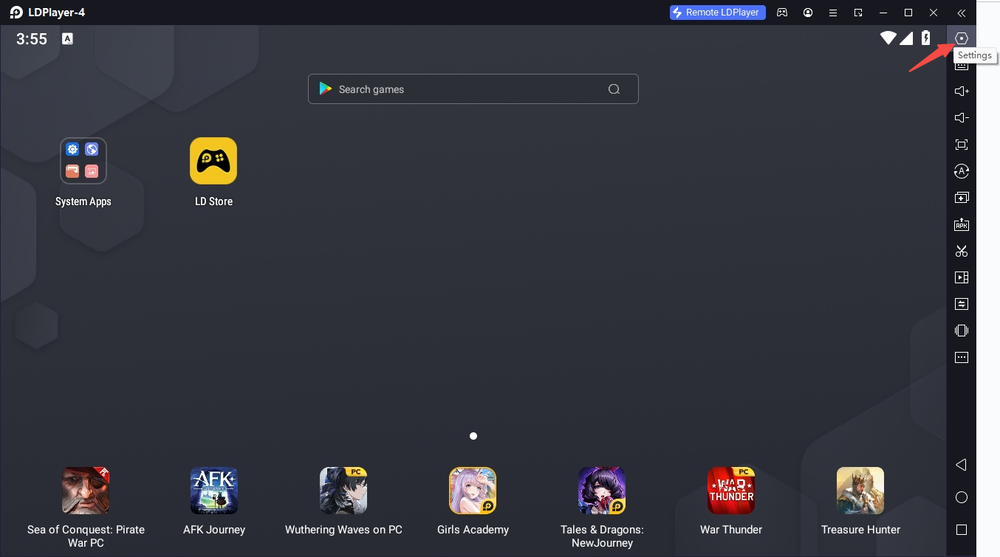
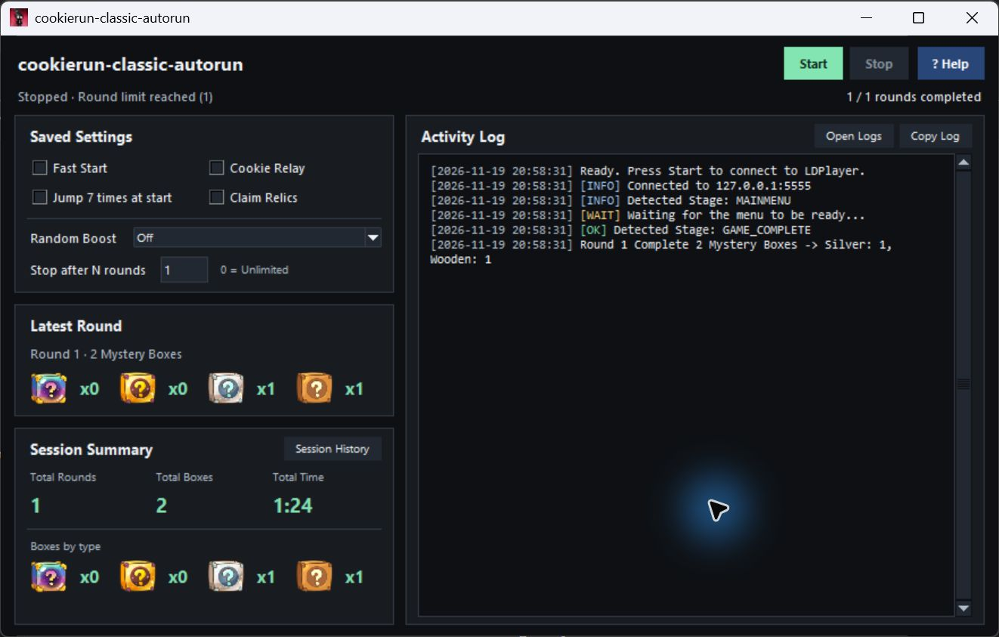
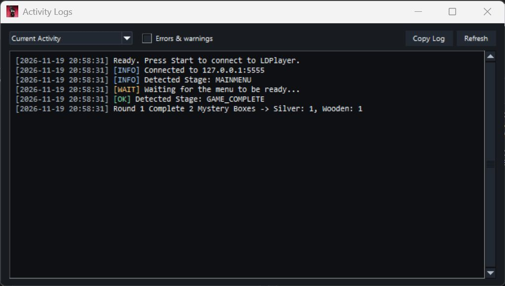

# ติดตั้ง cookierun-classic-autorun บน Windows

คู่มือนี้ใช้กับ Windows 10/11 แบบ 64 บิต ใช้อินเทอร์เน็ตตอนติดตั้ง Python ไลบรารี และเกม บนเครื่องใหม่ให้ตั้งค่า LDPlayer และ ADB ใหม่ ส่วนตัวเปิดแอปจะติดตั้งไลบรารีให้เอง

## 1. แตกไฟล์โปรแกรม

1. ถ้าได้รับ ZIP ให้คลิกขวาแล้วเลือก **Extract All…** ถ้าดาวน์โหลดจาก GitHub ของโปรเจกต์นี้ ให้กด **Code → Download ZIP** ก่อน สำหรับ repo แบบ Private ให้กดรับคำเชิญและลงชื่อเข้าใช้บัญชีที่ได้รับสิทธิ์
2. เปิดโฟลเดอร์ที่แตกแล้วจนเห็น **cookierun-classic-autorun.cmd** พร้อมกับ **desktop_ui.py**, โฟลเดอร์ **templates** และ **ui_assets** เก็บทุกไฟล์ไว้ด้วยกัน เช่นใน **C:\Games\cookierun-classic-autorun** ถ้าชื่อผู้ใช้ Windows มีอักษรไทย แนะนำให้แตกไฟล์ไว้ในโฟลเดอร์พาธภาษาอังกฤษ
3. หากย้ายจากเครื่องเดิม ให้ปิดแอปก่อน คัดลอกโฟลเดอร์โปรแกรมโดยเว้น **.venv** ถ้าต้องการค่าตั้งและประวัติเดิม ให้นำ **last_settings.json** และ **stats/** ไปด้วย


[วิธีดาวน์โหลด ZIP จาก GitHub](https://docs.github.com/en/repositories/working-with-files/using-files/downloading-source-code-archives)

## 2. ติดตั้ง Python 3.13

1. ที่ [หน้าดาวน์โหลด Python สำหรับ Windows](https://www.python.org/downloads/windows/) เลือก **Python 3.13 → Windows installer (64-bit)** แล้วเปิดไฟล์ติดตั้ง
2. ติ๊ก **Add python.exe to PATH** แล้วกด **Install Now** ถ้าเลือก **Customize installation** ให้ตรวจว่า **Python Launcher**, **Tcl/Tk** และ **pip** ถูกเลือก
3. เปิด PowerShell ใหม่จาก Start แล้วรัน **py -3.13 --version** ผลที่ต้องการคือ **Python 3.13.x**


[เอกสารติดตั้ง Python บน Windows](https://docs.python.org/3.13/using/windows.html#the-full-installer)

## 3. ติดตั้ง ADB และเพิ่มลงใน PATH

1. ที่ [Android SDK Platform-Tools → Downloads](https://developer.android.com/tools/releases/platform-tools#downloads) กด **Download SDK Platform-Tools for Windows** แล้วแตก ZIP
2. ย้ายโฟลเดอร์ **platform-tools** ไปไว้ในตำแหน่งที่จะเก็บประจำ เปิดโฟลเดอร์แล้วตรวจว่าเห็น **adb.exe** คลิกแถบที่อยู่ใน File Explorer แล้วคัดลอกพาธของโฟลเดอร์นั้น
3. กด Start แล้วค้นหา **Edit environment variables for your account** ใต้ **User variables** เลือก **Path → Edit → New** วางพาธของโฟลเดอร์ที่มี adb.exe แล้วกด **OK** ทุกหน้าต่าง
4. ปิด PowerShell เดิม เปิดใหม่ แล้วรัน **adb version** ผลที่ต้องการคือ **Android Debug Bridge version …**

[ตัวอย่างการใช้หน้าต่างตัวแปรระบบของ Windows](https://learn.microsoft.com/en-us/powershell/module/microsoft.powershell.core/about/about_environment_variables#use-the-system-control-panel)

## 4. ตั้งค่า LDPlayer และเช็กการเชื่อมต่อ

1. ติดตั้ง [LDPlayer](https://www.ldplayer.net/) และลง **CookieRun Classic** จาก Play Store ใน LDPlayer เปิดเกมครั้งแรกเพื่อดาวน์โหลดข้อมูลและตั้งค่าบัญชีจนถึงเมนูหลัก
2. กด **Settings** ที่แถบด้านขวาของ LDPlayer เข้า **Display** หรือ **Advanced** ตามรุ่น เลือกความละเอียด Android แนวนอน **1280 × 720** หากไม่มีในรายการให้เลือก **Customize** แล้วใส่ Width **1280** และ Height **720**
3. เข้า **Other settings → ADB debugging → Open local connection** กด **Save** แล้วปิดและเปิด LDPlayer ใหม่ ใช้ภาพด้านล่างเพื่อหาตำแหน่ง ADB debugging ส่วนค่า Root permission ให้คงค่าเดิมไว้
4. เปิด PowerShell แล้วรันตามลำดับ

```powershell
adb connect 127.0.0.1:5555
adb devices
adb -s 127.0.0.1:5555 shell wm size
```

ตรวจว่า **127.0.0.1:5555** ขึ้นสถานะ **device** และขนาดหน้าจอเป็น **1280x720** ถ้ามีทั้ง **Physical size** และ **Override size** ให้ดู **Override size** บางเครื่องอาจมี **emulator-5554** ขึ้นอีกบรรทัดได้

ถ้าเชื่อมไม่ได้ ให้ตรวจว่า LDPlayer ยังเปิดอยู่ แล้วเช็ก Local connection อีกครั้ง หากเปิด LDPlayer หลาย instance ให้ลองเหลือหนึ่ง instance ก่อน ถ้าเครื่องปลายทางใช้พอร์ตอื่น ให้ทดสอบด้วยพอร์ตนั้น และแก้ **DEVICE_PORT** ใน **config.py** ให้ตรงกัน



[ภาพหน้าตั้งค่าความละเอียด LDPlayer](https://www.ldplayer.net/support/how-to-switch-from-landscape-to-portrait.html) · [คู่มือพอร์ต ADB](https://www.ldplayer.net/support/ldplayer-adb-command-usage-guide.html)

## 5. เปิดแอปและทดลองหนึ่งรอบ

1. เปิดเกมให้ถึงเมนูหลัก แล้วดับเบิลคลิก **cookierun-classic-autorun.cmd** ครั้งแรกให้รอหน้าต่างติดตั้งสร้าง **.venv** และดาวน์โหลดไลบรารีจนแอปเปิด
2. ที่ **Settings** ตั้ง **Round Limit** เป็น **1** สำหรับทดสอบ ถ้าต้องการลองโดยไม่ซื้อบูสต์ ให้ปิด **Fast Start**, **Cookie Relay** และตั้ง **Random Boost** เป็น **Off**
3. กด **Start** ด้านขวาบน แล้วดู **Activity Log** ถ้าต้องการหยุดก่อนครบ ให้กด **Stop** และรอจนขึ้นสถานะหยุด
4. ดูผลใน **Latest Round** และ **Summary** ถ้าต้องการรันแบบไม่จำกัดจำนวนรอบ ให้ตั้ง **Round Limit** เป็น **0**



ภาพนี้จับจากแอปจริงโดยใช้ข้อมูลสาธิต

## 6. เปิดดู Log และแก้ปัญหา

กด **Open Logs** ใน Activity Log แล้วเลือก **Current Activity** หรือวันเวลาของรอบเก่า ติ๊ก **Error & Warnings** เพื่อกรอง และกด **Copy Log** เพื่อคัดลอกข้อความที่แสดง ส่วน **History** ใช้ดูสรุปย้อนหลังตามวันเวลา



| อาการ | วิธีตรวจ |
| --- | --- |
| หา py ไม่เจอ | เปิด PowerShell ใหม่แล้วรัน **py -3.13 --version** ตรวจการติดตั้ง Launcher ตามขั้นที่ 2 |
| หา ADB ไม่เจอ | รัน **adb version** แล้วตรวจว่า Path ชี้ไปยังโฟลเดอร์ที่มี **adb.exe** |
| เชื่อม LDPlayer ไม่ได้ | รัน **adb connect 127.0.0.1:5555** แล้วตรวจสถานะด้วย **adb devices** |
| เชื่อมได้ แต่อ่านจำนวนกล่องไม่ได้ | ตรวจความละเอียด **1280 × 720** แล้วดู **Open Logs** ถ้ามีข้อความ Windows OCR ให้ตรวจว่า Windows ติดตั้งภาษาที่รองรับ OCR |

ถ้าลงไลบรารีอัตโนมัติไม่ผ่าน ให้เปิดโฟลเดอร์โปรแกรมใน File Explorer พิมพ์ **powershell** ที่แถบที่อยู่แล้วกด Enter จากนั้นรันคำสั่งนี้และเปิด **cookierun-classic-autorun.cmd** อีกครั้ง

```powershell
py -3.13 -m venv .venv
.\.venv\Scripts\python.exe -m pip install -r requirements.txt
```
